Als Meta Modellierung wird die das Ändern des Notationsschemas bezeichnet. Es wird das sogenannte Meta Modell der jeweiligen Vorlage angepasst.
Es lassen sich Anpassungen am Verhalten und Aussehen der Modelle vornehmen, um bestimmte Informationen auszudrücken, die in einer Standardnotation nicht vorhanden oder darstellbar sind. So kann definiert werden welche Symbole verfügbar, welche Verbindungen zwischen Symbolen erlaubt sind und wie diese aussehen.

Da Meta Modelle nur mit Vorsicht und Wissen darüber wie das SemTalk Objektmodell funktioniert geändert werden sollten, sind die Dialoge für Anpassungen am Meta Modelle nur für Benutzer mit Administrator oder Meta Modellierer Rolle erlaubt.

# Eine neue Klasse graphisch anlegen und konfigurieren

Soll z.B. ein neues Symbol eingeführt werden, dass einer neuen SemTalk Objektklasse entspricht, muss diese Klasse im SemTalk Objekt-Modell angelegt und konfiguriert werden.

Es muss eine neue Unterklasse im bestehenden Metamodell angelegt werden. Im Beispielbild wird eine Klasse in einem BPMN Metamodell als Unterklasse der BPMN Flußobjekte angelegt. Dies ist ausschließlich als Beispiel zu sehen und kann sich je nach Notation und der Funktion, die die neue Klasse erfüllen soll, unterscheiden. Beispielhaft wird die Klasse "Anwendungssystemtyp" angelegt.

Da dies nur teilweise über die Dialogoberfläche gemacht werden kann, empfiehlt sich die graphische Modellierung. Es werden 3 Schritte benötigt:

### Ein Ontologie Diagramm anlegen und Klasse anlegen
Über den Menüpunkt Diagramm --> Neu findet sich die Möglichkeit ein neues Diagramm anzulegen. Um Metamodell-Klassen zu erstellen muss der Diagrammtyp "Ontologie" ausgewählt werden.
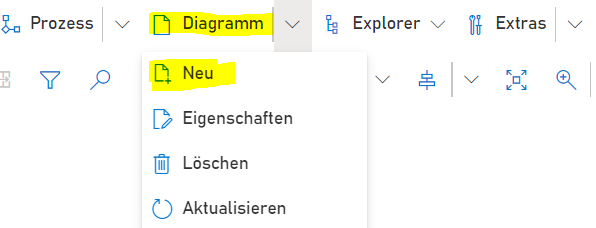
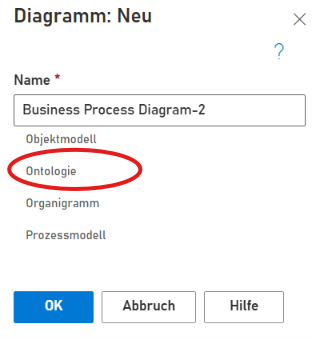

Damit die neue Klasse als Semtalk Systemklasse erkannt wird, muss die Klasse über das Metamodell Symbol angelegt werden. Dieses muss aus der Schablone auf das Zeichenblatt gezogen werden.

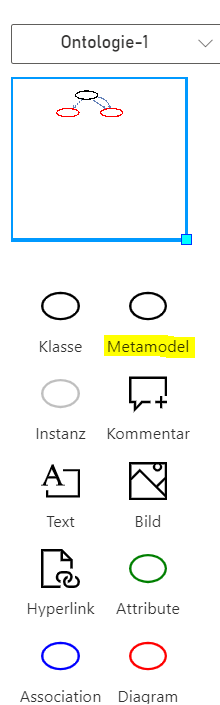

Anschließend wird dem Symbol der Name der neuen Klasse gegeben.

### Die Klasse in das Metamodell integrieren
 Die neue Klasse muss nun in das bestehende Metamodell integriert werden. Dafür muss sie mit zwei bestimmten Metamodell-Klassen verbunden werden. 
 Diese Klassen werden über das Diagramm Symbol dargestellt. Es wird daher das Diagram Symbol aus der Schablone auf das Zeichenblatt gezogen und dann mit Rechtsklick --> Auswählen ein Dialog geöffnet, welcher die bestehenden Klassen anzeigt. 
* Verknüpfen mit der "Flußobjekt" Klasse: Es wird "Flußobjekt" ausgewählt. Das Diagramm Symbol hat nun diesen Namen. Anschließend wird eine Verbindung von der neuen Klasse zur Flußobjekt Klasse gezogen. Die Verbindung sollte automatisch als Oberklasse angelegt werden. Mit Rechtsklick auf den Verbinder und dort im Kontextmenü Eigenschaften kann überpürft werden um welche Art Verbindung es sich handelt. Falls es sich nicht um eine Oberklasse handelt muss die Verbindung geändert werden (Auswählen auf dem Verbinder).

Hinweis: Evtl. ist es notwendig zuerst in den Optionen des Einfügen Dialogs die Anzeige für Metamodell Klassen zu aktivieren, damit diese eingefügt werden können.
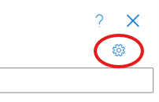
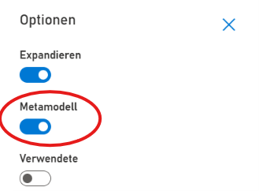

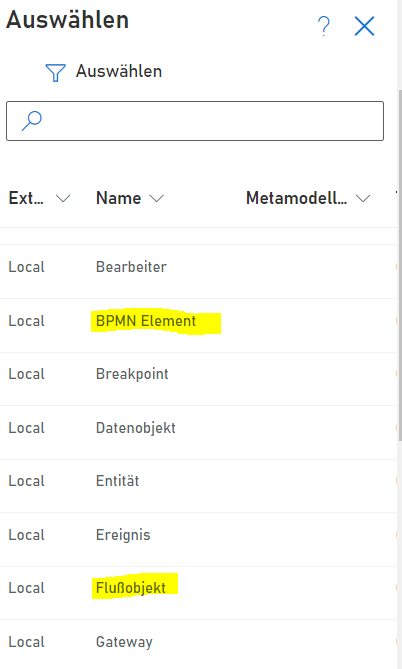

* Verknüpfen mit der "BPMN Element" Klasse: Es wird "BPMN Element" ausgewählt. Das Diagramm Symbol hat nun diesen Namen. Anschließend wird eine Verbindung von der neuen Klasse zur BPMN Element Klasse gezogen. Der Verbindungstyp muss diesmal direkt ausgewählt werden (Rechtsklick --> Auswählen). Dort wird "löst aus" gewählt und als Verbindertyp gesetzt. Anschließend wird ein zweiter Verbinder gezogen und dafür "wird ausgelöst von" gewählt.

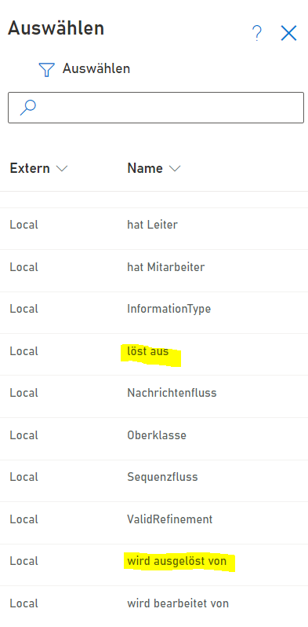

Das Zeichenblatt sollte in etwa so aussehen:
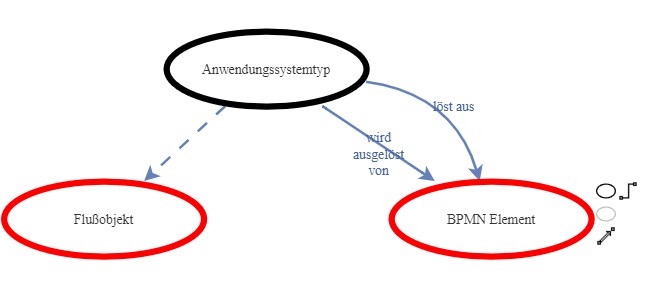

### Graphische Formatierung der neuen Klasse

Voraussetzung ist dass es das Symbol zur neuen Klasse bereits in der Schablone gibt. Dazu siehe [Wiki Seite: Schablonen-Editor](https://github.com/SemTalkOnline/SemTalkOnline_DE/wiki/Schablonen-Editor).

Wie ein Symbol der neuen Klasse auf dem Zeichenblatt dargestellt wird, kann ebenfalls konfiguriert werden.
Dafür wird der Formatierungsdialog genutzt. Um die Formatierung für eine Klasse anzulegen, empfiehlt es sich dies zuerst für ein Symbol über den Formatierungsdialog zu machen und das Ergebnis am Ende in die Klasse zu kopieren.
Hierfür wir das Symbol aus der Schablone auf das Zeichenblatt gezogen und der Formatierungsdialog geöffnet (Rechtklick auf das Symbol --> Formatierung; oder Menüpunkt Symbol --> Formatierung).
Welche Möglichkeiten es im Dialog gibt können hier [Wiki Seite: Formatierung](https://github.com/SemTalkOnline/SemTalkOnline_DE/wiki/Formatierung) im Detail nachgelesen werden.
Für das aktuelle Beispiel wird ein SVG Bild verwendet. Dafür wird im Tab "Symbol" bei der Symbol-Auswahlbox "Bild" ausgewählt und im Tab Bild eine URL zu dem SVG Bild hinterlegt.
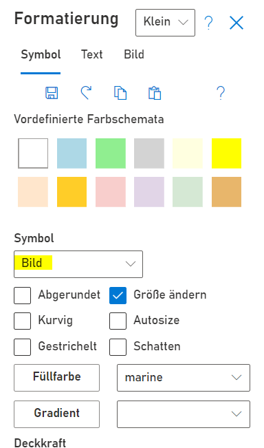

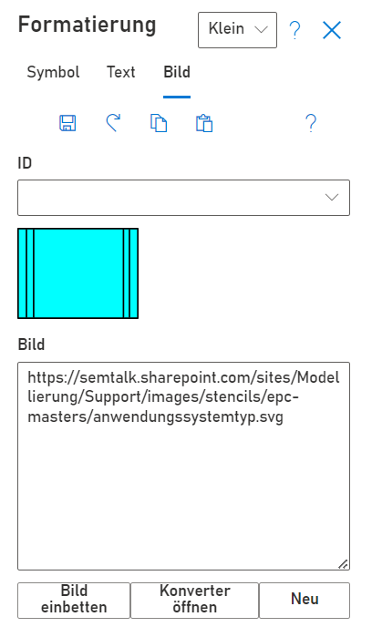

Anschließend wird das Format als Text, aus dem sich im Tab "Symbol" ganz unten befindlichen Feld "Formatierung", kopiert. 
Über den Menüpunkt Explorer --> Objekte kann über den Eintrag Flußobjekt zur neuen Klasse navigiert werden. Im 3 Punkte Menü ist der Eintrag "Anpassen" zu finden. Dort lässt sich das individuelle Verhalten und Aussehen der Klasse einstellen.
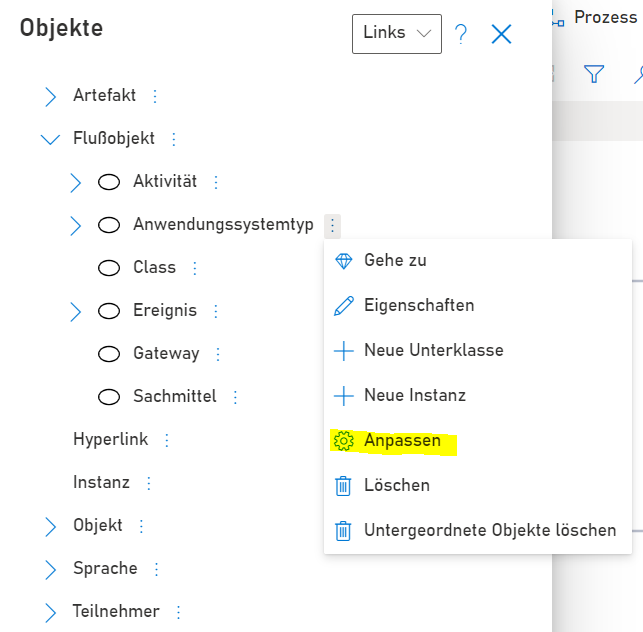

Im Feld "Formatierung" des Tabs "Formatierung" wird nun der kopierte Formattext eingefügt. Dieser ist nun auf die Klasse übertragen und wird automatisch genutzt, wenn ein neues Symbol dieser Klasse auf das Zeichenblatt gezogen wird.

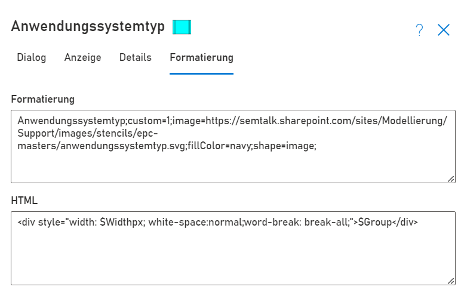

